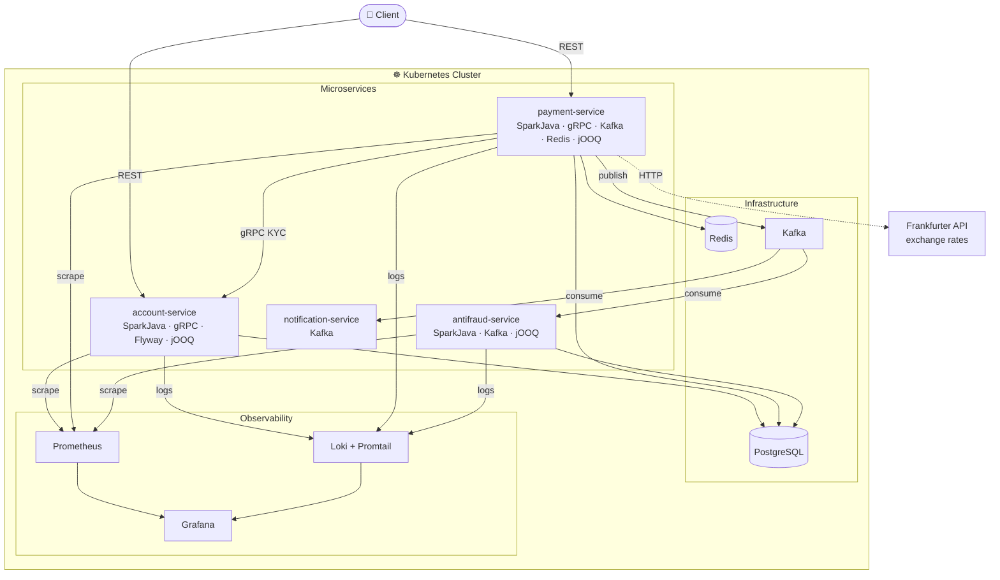
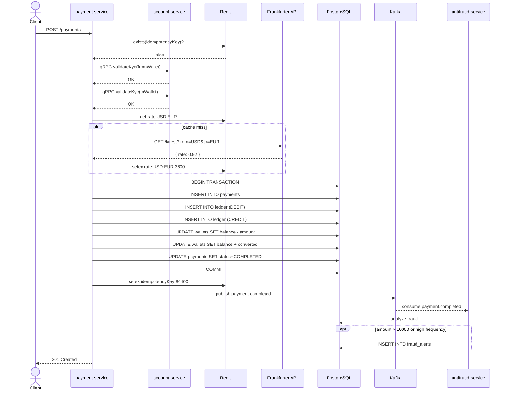
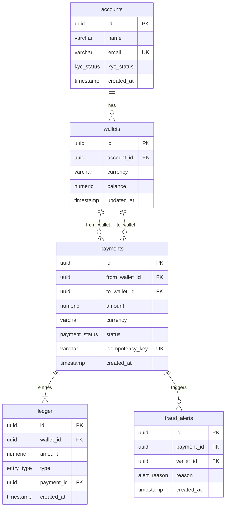
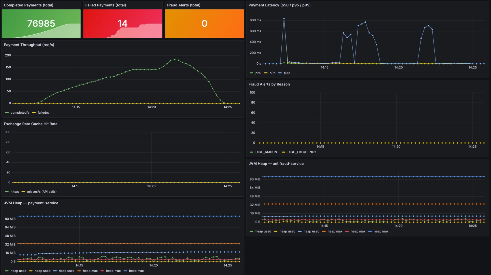
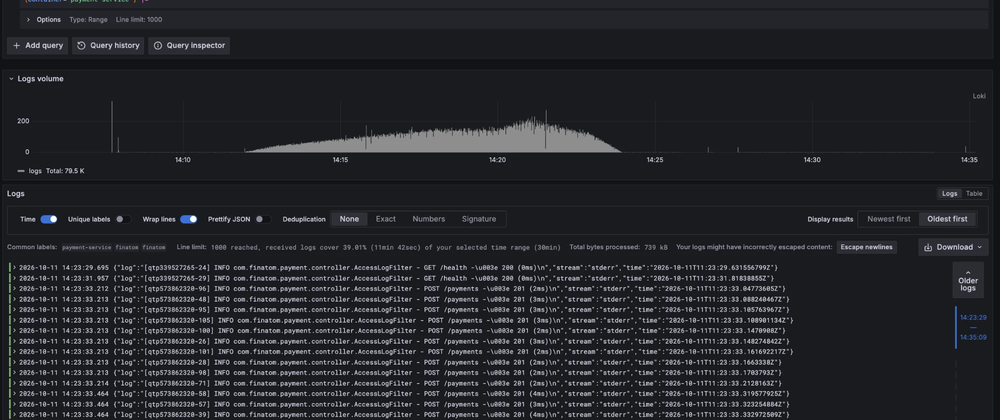

# FinAtom

Core banking engine simulating payment infrastructure behind modern neobanks (Revolut / Wise style). Built as a portfolio project to demonstrate production-grade microservices patterns in Java.

---

## Prerequisites

- Java 21
- Docker Desktop with Kubernetes enabled
- `make`

---

## Architecture



---

## Payment Flow



---

## Database Schema



---

## Tech Stack

| Layer | Technology |
|---|---|
| Language | Java 21 |
| HTTP | SparkJava |
| Database | PostgreSQL 16 |
| SQL | jOOQ (no ORM — typed SQL) |
| Migrations | Flyway |
| Connection Pool | HikariCP |
| Cache | Redis (idempotency keys, exchange rate cache) |
| Messaging | Apache Kafka |
| Service-to-service | gRPC (KYC validation) |
| Config | Typesafe Config |
| Metrics | Micrometer + Prometheus + Grafana |
| Logs | SLF4J + Loki + Promtail + Grafana |
| Tests | Spock Framework (BDD) + Testcontainers |
| Load testing | k6 |
| Infrastructure | Docker Compose + Kubernetes (Docker Desktop) |

---

## Key Engineering Decisions

**Idempotency** — duplicate payment requests never create a second transfer; Redis-backed keys with 24h TTL

**Double-spend protection** — pessimistic `balance >= amount` check inside a PostgreSQL transaction prevents concurrent overdrafts

**Audit trail** — every balance change recorded in an append-only ledger (DEBIT / CREDIT entries)

**Fraud detection** — high-amount (> $10k) and high-frequency (> 10 payments/60min) rules via Kafka consumer

**Exchange rate caching** — live rates from Frankfurter API cached in Redis (1h TTL) to avoid repeated external calls

**Clean architecture** — domain exceptions mapped to HTTP codes, typed record DTOs, wiring extracted to `AppConfig` classes

---

## Observability

77 000 payment requests processed under k6 load test (ramp 1→70 VUs, 12 min):



- **76 985** completed payments, **14** failed (99.98% success rate)
- Peak throughput **~180 req/s**, latency p99 < 800ms at spike
- JVM heap stable at 8–16 MiB — no memory leaks

Structured access logs shipped via Promtail → Loki, queryable in Grafana Explore:



---

## Services

| Service | Port | Responsibilities |
|---|---|---|
| account-service | 8081 | Accounts, multi-currency wallets, KYC, deposits |
| payment-service | 8082 | Transfers, currency conversion, idempotency, ledger |
| antifraud-service | 8083 | Fraud scoring, velocity rules |
| notification-service | — | Async event logging (Kafka consumer) |

---

## API

### account-service

```
POST   /accounts                  Create account (auto-creates USD/EUR/GBP wallets)
GET    /accounts/:id              Get account
GET    /accounts/:id/wallets      List wallets
PUT    /accounts/:id/kyc/verify   Verify KYC
POST   /wallets/:id/deposit       Deposit funds
```

### payment-service

```
POST   /payments                  Create payment (idempotent)
```

---

## Running

```bash
make docker-build   # build all Docker images
make deploy         # deploy to Kubernetes
make port-forward   # expose services on localhost
make load-test      # run k6 load test via Docker
make status         # show pod status
```

### Endpoints after `make port-forward`

| Service | URL |
|---|---|
| account-service API | http://localhost:8081 |
| payment-service API | http://localhost:8082 |
| Grafana dashboards | http://localhost:3000 (admin / finatom) |

---

## Testing

```bash
# Unit + integration tests (Spock BDD + Testcontainers)
./gradlew test
```

Integration tests spin up real containers and cover: balance transfers between accounts, idempotency, insufficient funds, ledger entries.
